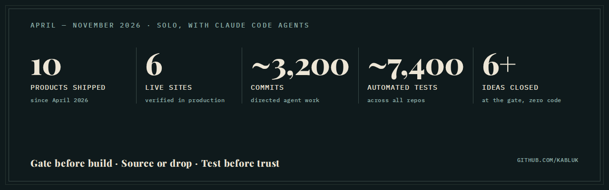
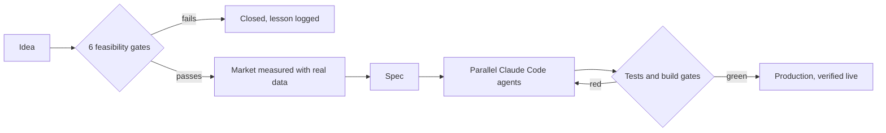
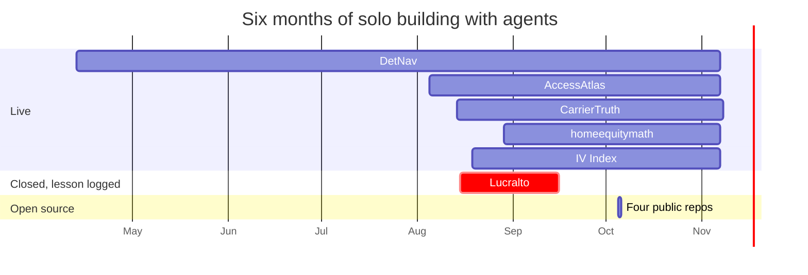

# Evgenii — I build with AI agents, and I don't trust them blindly

Solo builder in the US. I ship LLM apps and data pipelines by directing Claude Code agents,
then make the agents prove their work with sources, tests and build gates.

**Gate before build · Source or drop · Test before trust**

Open to early-career AI engineering and AI ops roles · remote, US

## How I work

## Open source

| Repo | Principle | What it is |
|---|---|---|
| [solo-ai-workshop](https://github.com/kabluk/solo-ai-workshop) | Gate before build | My operating system as a template: project registry, research that must end in a verdict, agent rules |
| [idea-gates](https://github.com/kabluk/idea-gates) | Gate before build | Claude Code skill: six feasibility gates before any market research |
| [llm-news-triage](https://github.com/kabluk/llm-news-triage) | Source or drop | Claude API pipeline where every claim cites its source or is dropped · 63 tests |
| [claude-code-kit](https://github.com/kabluk/claude-code-kit) | Test before trust | Subagents, commands, skills and hooks I reuse across 7+ repos |

## In production (closed source)

- **[CarrierTruth](https://carriertruth.com)**: 4.5M US trucking carriers from FMCSA open data. Daily snapshot-and-diff ETL on GitHub Actions + Cloudflare D1, 669K change events (478K detected since daily tracking began in August 2026). Remote [MCP server](https://carriertruth.com/mcp) for Claude (Cloudflare Workers, Streamable HTTP): 3 read-only tools, per-IP rate limit, 29 tests.
- **[AccessAtlas](https://verscala.com)**: accessibility-auditor directory and site scanner. Headless Chromium + axe-core on Cloudflare, Claude Haiku explains each finding, PDF fix plans. 575 agencies, 996 tests.
- **[DetNav](https://detnav.com)**: multilingual public-information service, ~1,150 pages in 4 languages, Stripe and WebAuthn, CI checks for translation parity. ~480 tests.
- **[homeequitymath](https://homeequitymath.com)**: 495 calculators and 32 unit converters (home equity, mortgage, home projects); lender rates re-verified against source pages and hidden when stale. 5,602 tests.
- **[IV Index](https://ivindex.com)**: mobile IV therapy directory where every price carries a source and a date. 646 providers in 30 metros, 776 pages.
- **[IMAGE Permanent Makeup](https://imagepmu.com)** (client site): studio site on Cloudflare Workers plus an AI phone receptionist on Vapi that answers the studio's line, books into the same Cal.com calendar as the website and sends call summaries to the owner. The prompt is generated from the site's service list, so phone and site cannot disagree. 33 tests.
- **FollowLens** (MVP in progress): cross-network follower tracker, Next.js + Supabase, Apify pipeline with retries and a plan-aware scheduler.

## Timeline

Case studies with screenshots, decisions and numbers: **[cases/](cases/)**

## Numbers I'm proud of

- **10** products and **6** live sites since April 2026, ~3,600 commits, ~7,800 automated tests
- **6+** ideas closed at the gate before a single line of code
- **63** tests on an open-source LLM pipeline where the model can only fail safely
- **1.4 s** sitemap response over 4.48M rows, down from HTTP 500

## Stack

Python · TypeScript · SQL · Claude API · Claude Code · Cloudflare Workers / D1 · GitHub Actions · pytest · Playwright

## Contact
[LinkedIn](https://www.linkedin.com/in/evgenii-sklyarov) · zincroom@gmail.com
